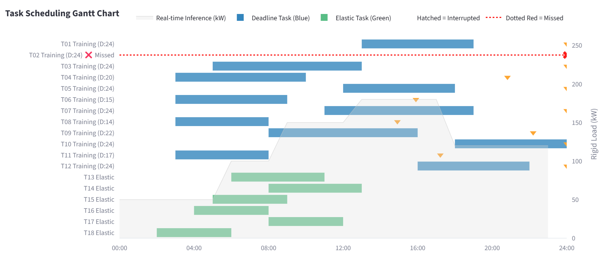
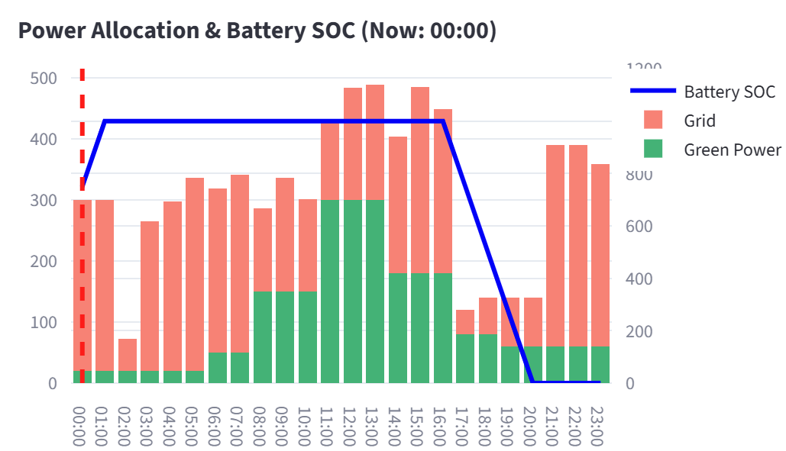
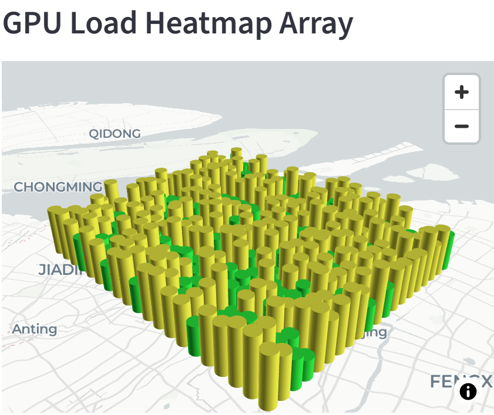

# ⚡ AI Data Center Compute-Power Co-Scheduling Demo

**Can AI clusters "wait for cheaper, greener electricity" without missing deadlines?**
This project is a Streamlit demo that co-schedules computing tasks and electricity for an AI data center. It shifts workloads in time, adjusts GPU compute tiers, splits long tasks, and coordinates battery storage — under dynamic grid prices, renewable supply, carbon intensity, and deadlines.

Built as a hackathon submission for the Track 2 problem statement (AI data center power scheduling).

---

## 📸 Screenshots


| Gantt chart | Power & battery | 3D GPU array |
|---|---|---|
|  |||

---


## ✨ What It Does

- Compares **four scheduling strategies** side by side on the same day:
  1. Baseline (First-Come, First-Served, no scheduling)
  2. Simple Off-Peak (delay to cheap hours)
  3. Greedy (cost-aware slot picking)
  4. **Smart Scheduling** (Greedy + Local Search with tier/shift/split moves + battery)
- Displays **cost, carbon, missed tasks, and battery cycles**, plus the gap to a theoretical lower bound.
- Runs **online robustness experiments**: how much does the schedule degrade when price forecasts are wrong (±10 % / ±20 % / ±30 %)?
- Renders a **3D GPU load heatmap** over Shanghai, updating with the time slider.

---

## 🚀 Quick Start

### Prerequisites

- Python **3.10+**
- A modern browser (Chrome / Edge / Firefox)

### Installation

```bash
# 1. Clone the repo
git clone https://github.com/<your-username>/<repo-name>.git
cd <repo-name>

# 2. Create a virtual environment (recommended)
python -m venv .venv
# Windows
.venv\Scripts\activate
# macOS / Linux
source .venv/bin/activate

# 3. Install dependencies
pip install -r requirements.txt
```

### Running

```bash
streamlit run app.py
```

Open http://localhost:8501 in your browser.

The **Online Robustness** page is in the sidebar (second page).

### Troubleshooting

| Symptom | Fix |
|---|---|
| `TypeError: ... unexpected keyword argument 'width'` | Your Streamlit is too old. Upgrade: `pip install -U streamlit>=1.40`. Or replace `width='stretch'` with `use_container_width=True` in the code. |
| `ModuleNotFoundError: No module named 'data'` | Run from the **repo root**, not from a subfolder. `app.py` expects `data/`, `scheduler/`, `viz/` to be siblings. |
| `Map tiles do not load` in the 3D view | Expected — the map style is intentionally disabled to keep the demo offline. Only the columns render. |

---

## 🗂 Project Structure

```
.
├── app.py                          # Main Streamlit page (single-day scheduling)
├── config.py                       # Global constants (capacity, battery, seed, λ)
├── requirements.txt
├── README.md
├── PROJECT_DESCRIPTION.md          # Problem interpretation & approach
├── TEST_EVIDENCE.md                # Test cases, expected vs actual, limitations
├── AI_USE_STATEMENT.md
├── data/
│   └── generator.py                # Builds the Problem object for each scenario
├── scheduler/
│   ├── model.py                    # Dataclasses: Task, Curves, Problem, Schedule
│   ├── metrics.py                  # Objective: cost + λ·carbon + battery + interrupt + SLA
│   ├── baseline.py                 # FCFS, rule-based, and lower bound
│   ├── greedy.py                   # Greedy cost-aware scheduler
│   ├── local_search.py             # Greedy + randomized local search
│   └── online_experiment.py        # Forecast-error simulation
├── viz/
│   ├── charts.py                   # Gantt, curves, power, 3D GPU deck
│   └── online_charts.py            # Degradation & forecast comparison plots
├── pages/
│   └── 2_Online_Robustness.py      # Robustness experiment page
└── tests/
    └── generate_test_report.py     # One-shot script that produces TEST_EVIDENCE numbers
```

---

## 🧠 How It Works

### The Problem

An AI data center has four dynamic inputs:

- **Grid price** — varies by hour (peak vs off-peak).
- **Green power availability** — solar generation peaks at midday.
- **Carbon intensity** — correlated with the grid mix.
- **Compute demand** — a set of tasks with different deadlines and power profiles.

The peak of cheap electricity is *not* the peak of green electricity, and neither is the peak of compute demand. My goal: **choose when and how each task runs so that total cost and carbon drop, while no deadline is missed**.

### Task Model

Each task has:

- `arrival` / `deadline` (may be 24 h if elastic)
- Three compute tiers: `slow` (0.6× power, 0.9× energy), `std` (1.0×), `fast` (1.5× power, 1.1× energy)
- `interruptible` flag, `max_interrupt` count, per-interrupt cost
- `kind`: `deadline` (hard) or `elastic` (flexible)

### The Four Strategies

| Strategy | Moves used | Purpose                     |
|---|---|-----------------------------|
| **Baseline (FCFS)** | None (queue on arrival) | Lower bound on common sense |
| **Simple Off-Peak** | Delay to hours with price ≤ 0.6 | Models "human intuition"    |
| **Greedy** | Slot + tier chosen by min `Σ(price + λ·carbon)·p` | First cost-aware algorithm  |
| **Smart Scheduling** | Greedy + Local Search over {tier-switch, ±4 h shift, split-with-gap} + battery | My method                   |

The **local search** runs up to 2000 randomized perturbations and accepts moves that don't degrade the objective by more than 5 % (simulated-annealing-style acceptance). The battery follows a simple threshold rule: discharge when price > 1.0, charge when < 0.4.

### Objective Function

```
minimize  cost + λ · carbon + c_batt · discharged_energy
        + interrupt_cost · #interrupts + 1000 · #missed_tasks
```

`λ` (CNY/kg CO₂) is exposed as a slider — the demo lets you see how the trade-off between "cheaper" and "greener" plays out.

---

## 📊 Data Sources & Assumptions

### Data Sources

**No real-world datasets are bundled.** The input curves in `data/generator.py` are hand-tuned, but their **ranges are grounded in public information**:

| Input | Source inspiration | Range used |
|---|---|---|
| Grid price (CNY/kWh) | Shanghai general industrial & commercial TOU tariff tiers | 0.3 (valley) / 0.6 (flat) / 1.2 (peak); 1.8 in "Price Spike" |
| Green availability (kW) | Typical PV daily profile | 20 at night → 300 at midday |
| Carbon intensity (kg CO₂/kWh) | East China grid daily intensity range | 0.3 (midday) – 0.85 (night) |
| Rigid load (kW) | Typical AI inference load on 500 kW capacity | 50 – 180 |
| Task durations / powers | Reasonable spread for small training & inference jobs | 3–8 h, 20–80 kW |

If you have a real TOU tariff or PV dataset, swap the four arrays in `generator.py` — everything downstream works unchanged.

### Key Assumptions

1. **Unit time step** (dt = 1 h) — no sub-hour granularity.
2. **Battery is a perfect linear reservoir** — no round-trip efficiency loss, no degradation, no temperature effects. Real systems typically see 85–92 % round-trip efficiency.
3. **Tasks are independent** — no data dependencies or pipelines.
4. **Tiers scale power and energy as constants** (`slow` = 0.6× power, 0.9× energy). Real DVFS curves are non-linear.
5. **Capacity 500 kW** applies per time slot; no ramp-rate or thermal throttling.
6. **Carbon intensity of green power is 0** — grid carbon is the only emission source.
7. **The "physical lower bound" is a relaxed analytic bound**, not a MILP optimum. It relaxes the capacity constraint and lets every task independently pick its cheapest slot.
8. **Forecast-error simulation perturbs grid price only** — green output, load, and task arrivals are treated as deterministic.
9. **Single day, single region** — no multi-day carry-over or geographic load balancing.
10. **No demand charge** (peak demand fee) — real data center bills often include this, which would make the case for batteries even stronger.

### Why These Assumptions

Each is a documented simplification that keeps the demo runnable in a hackathon. See `TEST_EVIDENCE.md` → "Known Limitations" for the specific impact of each.

---

## 📈 Interpreting the Dashboard

| Panel | What it shows | What to look for |
|---|---|---|
| Gantt chart | Every task's tier and time slots, plus rigid load (gray) and deadlines (▽ orange) | Blue = deadline task, green = elastic, hatched = interrupted, red dotted line + ❌ = **missed** |
| Power & carbon curves | Grid price, scaled green output, carbon intensity | The three curves peak at different hours — this mismatch is the *reason* scheduling helps |
| Power allocation | Stacked green + grid consumption, battery SOC | Battery charging at night, discharging at evening peak |
| Key metrics | Total cost, carbon, missed tasks, battery cycles | Δ vs baseline shown below the number |
| Gap to limit | Percent gap between your solution and the theoretical lower bound | A smaller gap = closer to optimum |
| GPU array | 20×20 = 400 GPUs rendered over Shanghai | Color/height reflect average load at the selected hour |

---

## 🧪 Testing

See [`TEST_EVIDENCE.md`](TEST_EVIDENCE.md) for:
- Representative test cases
- Expected vs actual results
- Reproducible test commands
- Known limitations

To regenerate the numbers yourself:

```bash
python tests/generate_test_report.py
```

This prints a Markdown table covering all 4 scenarios × 3 strategies, plus the lower bound.

---

## ⚠️ Known Limitations

- **Battery is ideal** — see assumption 2. Real batteries would reduce the reported savings.
- **No real forecast model** — errors are simulated as uniform multiplicative noise, not from a physical weather model.
- **Lower bound is loose** — reported "gap to limit" is a *warm* bound, not a certificate of optimality. See `TEST_EVIDENCE.md` for discussion.
- **Local search is stochastic** — results differ across runs; I report averages over multiple seeds in `TEST_EVIDENCE.md`.
- **Single-region** — real data centers balance load across regions with different prices and climates.
- **No demand charge** — see assumption 10.
- **Data center only** — the model does not include network transmission, cooling PUE differences across hours, or hardware failure risk.

---

## 👥 Author


Bruce Cheng

---

## 📄 License

Released under the MIT License — free to use and modify for educational purposes.

---

## 🙏 Acknowledgements

- Problem statement: Track 2, SHSID Hackathon.
- Deepseek with coding and inspirations.
- Built with Streamlit, Plotly, and PyDeck.